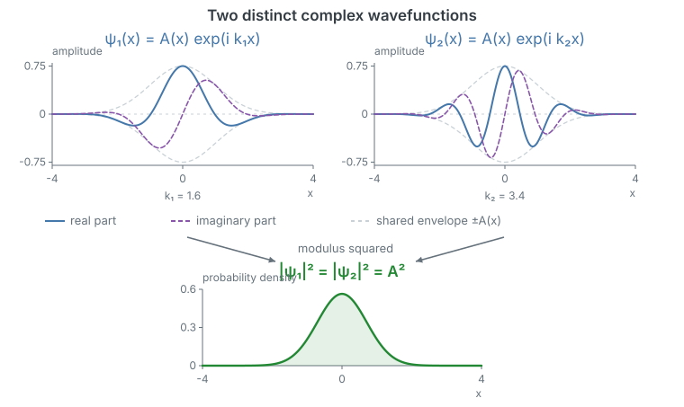
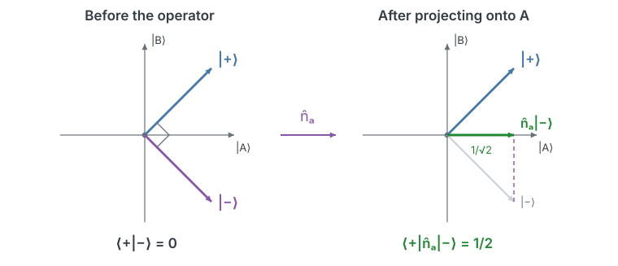
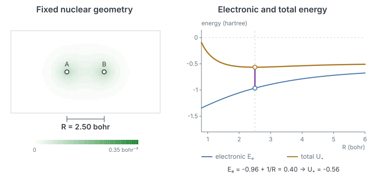
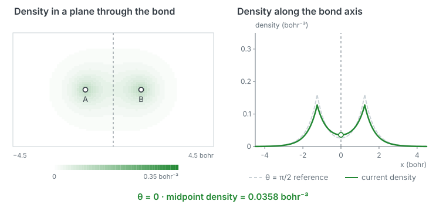
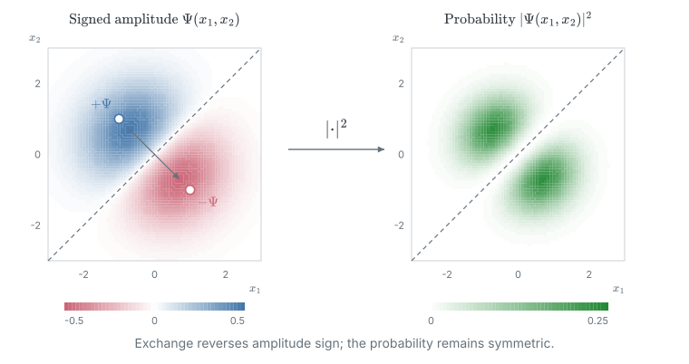
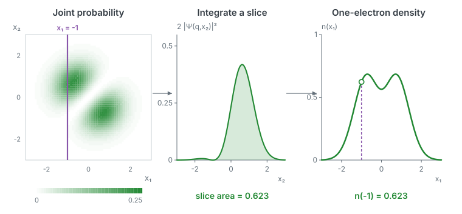
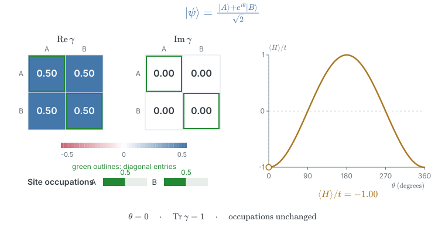
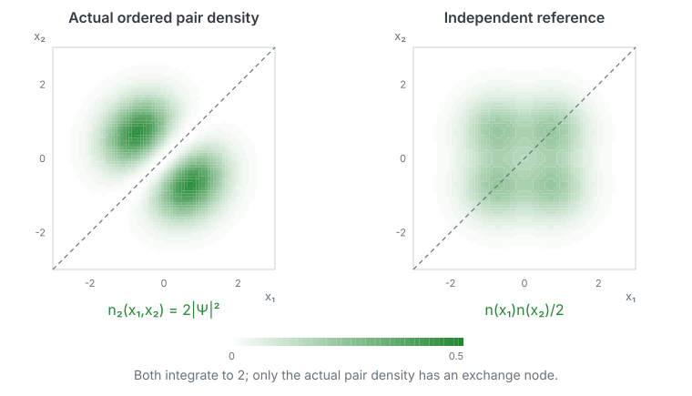

*Quantum Mechanics for Chemical Reactions and Enzyme Design · Part I*

A molecule is often represented as a graph: atoms are nodes, and chemical bonds are edges. This representation is extraordinarily useful, but it hides a fundamental question. What, physically, makes two atoms bonded? There is no explicit bond variable in the fundamental molecular Hamiltonian. There are electrons, atomic nuclei, and interactions between them. Bonds emerge from their quantum-mechanical behavior.

To understand how a chemical reaction occurs, or how an enzyme changes its course, we therefore need a representation that goes beyond molecular connectivity. We need to describe electronic states, identify the physical laws that govern them, and understand how measurable molecular properties arise from those states.

This article develops that language. Starting with the wavefunction, we will arrive at the molecular Hamiltonian, orbitals, electron density, and the one-particle reduced density matrix (1-RDM). Each is a different mathematical object, and the distinctions between them matter. Throughout, I will use three progressively richer systems: the hydrogen atom, the hydrogen molecular ion $\mathrm{H}_2^+$, and the hydrogen molecule $\mathrm{H}_2$. Familiarity with linear algebra, calculus, and elementary probability is assumed; prior knowledge of quantum chemistry is not.

## 1. A quantum state is more than a probability distribution

In classical mechanics, the instantaneous state of a particle can be specified by its position $\mathbf r$ and momentum $\mathbf p$. Quantum mechanics instead describes a pure state by a vector in a complex Hilbert space, denoted $|\Psi\rangle$. A Hilbert space is an inner-product space with a completeness property that allows convergent sequences of states to have well-defined limits. For a single particle, its position-space wavefunction is a complex-valued function $\Psi(\mathbf r)$.

The wavefunction is not a probability density. According to the Born rule, the probability of finding the particle within a spatial region $\Omega$ is

$$
P(\mathbf r\in\Omega)=\int_{\Omega}|\Psi(\mathbf r)|^2\,d^3\mathbf r.
$$

Here $d^3\mathbf r$ is the three-dimensional volume element, and $|\Psi|^2=\Psi^*\Psi$, where the asterisk denotes complex conjugation. A normalized wavefunction satisfies

$$
\int_{\mathbb R^3}|\Psi(\mathbf r)|^2\,d^3\mathbf r=1.
$$

Why retain the complex amplitude instead of working directly with its probability density? The reason is interference. If two normalized states have wavefunctions $\psi_A$ and $\psi_B$, a superposition proportional to $\psi_A+e^{i\theta}\psi_B$ has an unnormalized squared amplitude

$$
|\psi_A+e^{i\theta}\psi_B|^2
=|\psi_A|^2+|\psi_B|^2
+2\operatorname{Re}\!\left[e^{i\theta}\psi_A^*\psi_B\right].
$$

The last term is the interference term. It depends on the relative phase $\theta$, which is absent from the individual probability densities. Depending on this phase, amplitudes can reinforce or cancel each other. Multiplying an entire state by a common phase $e^{i\theta}$, however, does not change its physical predictions. It is relative phase that matters.

<figure class="qm-figure" data-qm-kind="phase-information" markdown="0">

<figcaption><strong>Figure 1. Different states can share the same density.</strong> Analytical illustration. Two normalized one-dimensional wave packets have the same Gaussian envelope A(x) = π⁻¹/⁴ exp(−x²/2), but different spatial phases, k₁x and k₂x. The solid and dashed curves show their real and imaginary parts. Taking the modulus squared removes both phase functions, producing identical densities. Coordinates and wave numbers are dimensionless; this is not a time-evolution simulation. <a class="qm-full" href="/images/notes/quantum-mechanics/phase-information.svg">Static figure</a></figcaption>
</figure>

Consider a simplified system with one electron and two orthonormal localized states, $|A\rangle$ and $|B\rangle$. The states

$$
|+\rangle=\frac{|A\rangle+|B\rangle}{\sqrt2},\qquad
|-\rangle=\frac{|A\rangle-|B\rangle}{\sqrt2}
$$

both assign probability $1/2$ to an occupancy measurement at either site. Nevertheless, they are orthogonal quantum states. An observation sensitive to their relative phase can distinguish them. Later, we will see that they can also have different energies. This simple example is already a reason not to equate a quantum state with its density.

## 2. The linear algebra of quantum mechanics

The notation $|\Psi\rangle$ is called a *ket*. In a finite-dimensional orthonormal basis, it is represented by a column vector. Its adjoint, called a *bra*, is denoted $\langle\Psi|$. If the coefficients of a state in a two-dimensional basis are $a$ and $b$, then

$$
|\Psi\rangle=\begin{pmatrix}a\\b\end{pmatrix},\qquad
\langle\Psi|=\begin{pmatrix}a^*&b^*\end{pmatrix}.
$$

The inner product $\langle\Phi|\Psi\rangle$ measures the overlap of two states. In position space, it becomes an integral:

$$
\langle\Phi|\Psi\rangle
=\int\Phi^*(\mathbf r)\Psi(\mathbf r)\,d^3\mathbf r.
$$

Normalization is simply $\langle\Psi|\Psi\rangle=1$. For normalized states, the squared magnitude of their inner product is the probability of finding one state when projecting onto the other. Orthogonal states have zero inner product.

A complete orthonormal basis $\{|k\rangle\}$ satisfies $\langle j|k\rangle=\delta_{jk}$, where the Kronecker delta is one if $j=k$ and zero otherwise. Completeness means that the identity operator can be resolved as

$$
I=\sum_k|k\rangle\langle k|.
$$

Applying this identity to a state gives $|\Psi\rangle=\sum_k|k\rangle\langle k|\Psi\rangle$. Thus, the coefficients of a ket are obtained by projecting it onto the basis vectors. The position representation follows the same idea, with a continuous, generalized position basis $|\mathbf r\rangle$:

$$
\Psi(\mathbf r)=\langle\mathbf r|\Psi\rangle.
$$

A ket and a wavefunction are therefore not two separate physical objects. The ket is the abstract state; the wavefunction is its representation in a particular basis.

The order of a bra and a ket matters. The inner product $\langle\Phi|\Psi\rangle$ is a scalar, whereas the outer product $|\Psi\rangle\langle\Phi|$ is an operator. When $|\Psi\rangle$ is normalized, $|\Psi\rangle\langle\Psi|$ projects onto that state. This outer-product structure will return when we construct density matrices.

### Extracting physical information from a state

A quantum state encodes physical information, but to extract a particular quantity we need an *operator*. An operator $\hat A$ is a linear map acting on states. Physical observables such as energy and momentum are represented by self-adjoint operators (Hermitian matrices in finite dimensions).

If a state $|a_k\rangle$ satisfies

$$
\hat A|a_k\rangle=a_k|a_k\rangle,
$$

it is an eigenstate of $\hat A$, and $a_k$ is the corresponding eigenvalue. Measuring the observable in this state gives $a_k$ with certainty. For a general normalized state, its expectation value is

$$
\langle A\rangle=\langle\Psi|\hat A|\Psi\rangle.
$$

An expectation value is the average over repeated measurements on identically prepared states, not necessarily an outcome of an individual measurement.

More generally, a matrix element $\langle\Phi|\hat A|\Psi\rangle$ measures how strongly the action of $\hat A$ on $|\Psi\rangle$ projects onto $|\Phi\rangle$. This is a different object from the overlap $\langle\Phi|\Psi\rangle$: two orthogonal states can have a nonzero operator matrix element.

For example, the site-$A$ occupation operator in our two-site model is $\hat n_A=|A\rangle\langle A|$. Its matrix element between the two orthogonal superpositions introduced above is

$$
\langle+|\hat n_A|-\rangle=\frac12,
\qquad \langle+|-\rangle=0.
$$

This distinction is central to perturbation theory. Orthogonality alone does not prevent an external perturbation from coupling two quantum states.

<figure class="qm-figure" data-qm-kind="operator-projection" markdown="0">

<figcaption><strong>Figure 2. An operator changes the geometry of an overlap.</strong> Exact two-site model. The blue and purple unit vectors are orthogonal. Projection onto the A basis vector preserves only the A component of the purple state, so its overlap with the blue state is nonzero. The gray vector is the original state, and the dashed line shows the removed B component. <a class="qm-full" href="/images/notes/quantum-mechanics/operator-projection.svg">Static figure</a></figcaption>
</figure>

## 3. The Hamiltonian: what determines a molecular state?

Among all quantum operators, the Hamiltonian $\hat H$ occupies a special position. It represents energy and generates time evolution according to the time-dependent Schrödinger equation,

$$
i\hbar\frac{\partial}{\partial t}|\Psi(t)\rangle=\hat H(t)|\Psi(t)\rangle,
$$

where $i^2=-1$, $\hbar$ is the reduced Planck constant, and $t$ is time. For a time-independent Hamiltonian, its stationary states satisfy

$$
\boxed{\hat H|\Psi_m\rangle=E_m|\Psi_m\rangle.}\tag{1}
$$

This is the time-independent Schrödinger equation. The eigenvalues $E_m$ are the allowed energies, and the eigenstates $|\Psi_m\rangle$ describe the corresponding quantum states. The ground state has the lowest energy; states of higher energy are excited states. A stationary eigenstate evolves only by an overall phase $e^{-iE_mt/\hbar}$, leaving its position probability density unchanged.

Equation (1) is an eigenvalue problem. Its mathematical form resembles a matrix eigendecomposition, but the molecular Hamiltonian acts on functions of many particle coordinates and generally cannot be solved exactly.

### The molecular Hamiltonian

Consider a nonrelativistic molecule with $N$ electrons and $M$ nuclei. Let $\mathbf r_i$ be the coordinate of electron $i$, $\mathbf R_A$ the coordinate of nucleus $A$, and $Z_A$ the nuclear charge number. For the remainder of this article, I use atomic units, in which $\hbar=m_e=e=4\pi\varepsilon_0=1$; energies are measured in hartrees and distances in bohr.

In the absence of an external field, the Coulomb Hamiltonian is

$$
\boxed{\begin{aligned}
\hat H={}&-\frac12\sum_{i=1}^{N}\nabla_i^2
-\sum_{A=1}^{M}\frac{1}{2\mathcal M_A}\nabla_A^2\\
&-\sum_{i,A}\frac{Z_A}{|\mathbf r_i-\mathbf R_A|}
+\sum_{i<j}\frac{1}{|\mathbf r_i-\mathbf r_j|}\\
&+\sum_{A<B}\frac{Z_AZ_B}{|\mathbf R_A-\mathbf R_B|}.
\end{aligned}}\tag{2}
$$

Here $\mathcal M_A$ is the mass of nucleus $A$ in electron-mass units. The Laplacians $\nabla_i^2$ and $\nabla_A^2$ are sums of second derivatives with respect to the corresponding Cartesian coordinates. Reading Eq. (2) from left to right gives the electron and nuclear kinetic energies, electron–nucleus attraction, electron–electron repulsion, and nucleus–nucleus repulsion. The restrictions $i<j$ and $A<B$ prevent double counting particle pairs.

The kinetic-energy terms deserve attention. For a normalized one-electron wavefunction with appropriate boundary conditions, integration by parts gives

$$
\left\langle-\frac12\nabla^2\right\rangle
=\frac12\int|\nabla\Psi(\mathbf r)|^2\,d^3\mathbf r.
$$

Rapid spatial variation of the wavefunction carries a kinetic-energy cost. Electronic structure consequently reflects a competition between spatial delocalization, attraction to nuclei, electron repulsion, and quantum constraints. None of the terms in Eq. (2) explicitly represents a chemical bond.

### Separating electronic and nuclear motion

Atomic nuclei are much heavier than electrons. The Born–Oppenheimer approximation exploits the resulting separation of electronic and nuclear motion by first solving the electronic problem at fixed nuclear coordinates $\mathbf R=(\mathbf R_1,\ldots,\mathbf R_M)$.

The clamped-nuclei electronic Hamiltonian is

$$
\hat H_e(\mathbf R)=-\frac12\sum_i\nabla_i^2
-\sum_{i,A}\frac{Z_A}{|\mathbf r_i-\mathbf R_A|}
+\sum_{i<j}\frac{1}{|\mathbf r_i-\mathbf r_j|}.
$$

For each geometry, we solve

$$
\hat H_e(\mathbf R)|\Psi_m(\mathbf R)\rangle
=E_{e,m}(\mathbf R)|\Psi_m(\mathbf R)\rangle.
$$

The ground-state Born–Oppenheimer potential energy surface is then

$$
U_0(\mathbf R)=E_{e,0}(\mathbf R)
+\sum_{A<B}\frac{Z_AZ_B}{|\mathbf R_A-\mathbf R_B|}.
\tag{3}
$$

The nuclear repulsion is constant during an electronic calculation at a fixed geometry, but changes when the nuclei move, so it must be included in the potential energy surface.

Equation (3) explains why geometry and electronic structure are inseparable. Moving nuclei changes the electron–nucleus potential, producing a different electronic eigenvalue problem. A chemical transition state is a saddle point on a reaction energy landscape, not necessarily an electronic excited state: its electrons may still occupy the ground electronic state at that particular geometry. The Born–Oppenheimer separation can become unreliable near electronic degeneracies or when transitions between electronic surfaces matter.

<figure class="qm-figure" data-qm-kind="born-oppenheimer" markdown="0">

<label for="qm-born-oppenheimer">Internuclear separation R (bohr): <output for="qm-born-oppenheimer">2.50 bohr</output></label>
<input type="range" id="qm-born-oppenheimer" min="0.8" max="6" step="0.05" value="2.5">

<button type="button" data-qm-play aria-pressed="false">Play sweep</button><button type="button" data-qm-reset>Reset</button>Parameter sweep, not physical time

<figcaption><strong>Figure 3. A different nuclear geometry defines a different electronic problem.</strong> Interactive analytical model of H₂⁺ using a fixed-exponent hydrogen 1s basis (minimal-basis variational approximation). Change the internuclear separation to see the normalized symmetric orbital density in the bond plane and the corresponding energy components. The purple vertical segment is the direct nuclear repulsion 1/R; adding it to the electronic energy yields the total Born–Oppenheimer curve. The slider is a geometry parameter sweep, not a nuclear trajectory. This is not an exact molecular calculation. <a class="qm-full" href="/images/notes/quantum-mechanics/born-oppenheimer.svg">Static figure</a></figcaption>
</figure>

An external electrostatic potential $\phi_{\mathrm{ext}}(\mathbf r)$ enters the electronic Hamiltonian as

$$
\hat H'_e=\hat H_e-\sum_i\phi_{\mathrm{ext}}(\mathbf r_i),
$$

in atomic units. The minus sign reflects the negative electron charge. The corresponding direct nuclear contribution to the total potential energy is $\sum_A Z_A\phi_{\mathrm{ext}}(\mathbf R_A)$. A spatially constant potential shifts energies but does not change the electronic eigenstates at fixed electron number. A spatially varying potential generally changes both energies and wavefunctions. This is the starting point for our later discussion of electrostatic catalysis.

## 4. Why orbitals enter the picture

For a hydrogen atom with its nucleus fixed at the origin, the electronic Hamiltonian reduces to

$$
\hat H_e=-\frac12\nabla^2-\frac1r,
$$

where $r=|\mathbf r|$. The normalized ground-state spatial wavefunction is $\psi_{1s}(\mathbf r)=\pi^{-1/2}e^{-r}$, with energy $-1/2$ hartree. This is the hydrogen $1s$ orbital. Its squared amplitude is a spherically symmetric probability density. Other hydrogen orbitals, such as $2p$, have different angular structure, energies, and nodes, where the wavefunction vanishes.

In a one-electron system, a spatial orbital together with its spin state can describe the entire electronic state. In a many-electron molecule, however, an orbital is a one-electron function used to represent a much more complicated quantum state. The full electronic wavefunction depends on all electron coordinates simultaneously.

### Building molecular orbitals from atomic functions

The hydrogen molecular ion $\mathrm H_2^+$ consists of two protons and one electron. Its electronic Hamiltonian contains attraction to both nuclei. A useful approximation starts with two real hydrogen $1s$ functions, $\phi_A(\mathbf r)$ and $\phi_B(\mathbf r)$, centered on the two protons. The molecular orbitals are approximated as linear combinations of these atomic functions.

Define the overlap $S=\langle\phi_A|\phi_B\rangle$. The normalized symmetric and antisymmetric combinations are

$$
\psi_\pm(\mathbf r)=
\frac{\phi_A(\mathbf r)\pm\phi_B(\mathbf r)}{\sqrt{2(1\pm S)}}.
$$

The corresponding densities are

$$
|\psi_\pm|^2=
\frac{|\phi_A|^2+|\phi_B|^2\pm2\phi_A\phi_B}{2(1\pm S)}.
$$

This is the same interference phenomenon we encountered in Section 1. The symmetric combination increases electron density in the internuclear region relative to the antisymmetric combination, which has a node at the midpoint and a nodal plane between the protons. They are the familiar bonding and antibonding combinations. Their energy ordering must ultimately be established from the Hamiltonian, not merely from a picture of the density.

<figure class="qm-figure" data-qm-kind="orbital-interference" markdown="0">

<label for="qm-orbital-interference">Relative phase θ: <output for="qm-orbital-interference">0°</output></label>
<input type="range" id="qm-orbital-interference" min="0" max="180" step="1" value="0">

<button type="button" data-qm-play aria-pressed="false">Play sweep</button><button type="button" data-qm-reset>Reset</button>Parameter sweep, not physical time

<figcaption><strong>Figure 4. Relative phase controls the density between the nuclei.</strong> Interactive analytical visualization. Two real hydrogen 1s functions are centered at a fixed separation of 2.5 bohr. At each phase θ the superposition is normalized by √(2 + 2S cos θ), where S is their overlap. The left panel is a plane through the bond; the right panel samples that same density along the bond axis, on a fixed absolute scale. The midpoint density becomes exactly zero at θ = π. The sweep is a comparison of states, not physical time evolution. <a class="qm-full" href="/images/notes/quantum-mechanics/orbital-interference.svg">Static figure</a></figcaption>
</figure>

For a more general linear combination $\psi_a=\sum_{\mu} C_{\mu a}\phi_\mu$ (where $\mu$ labels basis functions), the effective one-electron eigenvalue equation becomes

$$
\mathbf h\mathbf c_a=\epsilon_a\mathbf S\mathbf c_a,
$$

where $h_{\mu\nu}=\langle\phi_\mu|\hat h|\phi_\nu\rangle$, $S_{\mu\nu}=\langle\phi_\mu|\phi_\nu\rangle$, and $\mathbf c_a$ is the vector of orbital expansion coefficients. The overlap matrix $\mathbf S$ is the identity only for an orthonormal basis. The operator $\hat h$ is a one-electron Hamiltonian or an effective one-electron operator, depending on the method.

Orbital overlap and Hamiltonian coupling are related but not identical. Orthogonal localized orbitals may still have a nonzero off-diagonal Hamiltonian matrix element. Conversely, choosing the Hamiltonian's eigenbasis makes its matrix diagonal. Thus, an individual coupling matrix element depends on the chosen representation, whereas the eigenvalues do not.

### A two-orbital model of bonding

Return to our orthonormal localized states $|A\rangle$ and $|B\rangle$. A minimal symmetric Hamiltonian is

$$
\mathbf H=\begin{pmatrix}0&-t\\-t&0\end{pmatrix},\qquad t>0,
$$

where $t$ is a coupling energy and the zero of energy is chosen at the common site energy. Its eigenstates are $|+\rangle$ and $|-\rangle$, with energies $-t$ and $+t$, respectively. Both have the same site occupations, but their relative phases cause the off-diagonal Hamiltonian contribution to have opposite signs. Here stronger coupling increases the energy splitting $2t$.

This is an illustrative tight-binding model, not a quantitative Hamiltonian for $\mathrm H_2^+$. It captures a fundamental point: a chemical description based only on atomic occupations cannot generally distinguish bonding from antibonding states.

In realistic quantum chemistry, orbitals can arise in several ways. Hartree–Fock orbitals come from a self-consistent single-determinant approximation. Kohn–Sham orbitals belong to an auxiliary noninteracting system constructed to reproduce the ground-state density. Natural orbitals, which we will meet below, are eigenfunctions of the 1-RDM. These definitions are not interchangeable, and an orbital is not generally a classical trajectory or an identifiable individual electron.

## 5. Many electrons: the wavefunction becomes a collective object

Adding a second electron to $\mathrm H_2^+$ gives $\mathrm H_2$. This introduces an interaction that no single-electron model contains: electron–electron repulsion.

Let $x_i=(\mathbf r_i,s_i)$ denote the position and spin coordinate of electron $i$. A normalized $N$-electron wavefunction has the form

$$
\Psi(x_1,\ldots,x_N),\qquad
\int|\Psi(x_1,\ldots,x_N)|^2\,dx_1\cdots dx_N=1,
$$

where integration over $x_i$ means spatial integration and summation over its spin coordinate. The spatial part lives in a $3N$-dimensional configuration space, not ordinary three-dimensional physical space.

Electrons are indistinguishable fermions. Exchanging any two electron coordinates, including their spins, changes the sign of the full wavefunction:

$$
\Psi(\ldots,x_i,\ldots,x_j,\ldots)
=-\Psi(\ldots,x_j,\ldots,x_i,\ldots).
$$

A product of independent one-electron functions does not generally have this property. Given two orthonormal spin orbitals $u_a(x)$ and $u_b(x)$, antisymmetry is imposed by the Slater determinant

$$
\Psi(x_1,x_2)=\frac1{\sqrt2}
\begin{vmatrix}
u_a(x_1)&u_b(x_1)\\
u_a(x_2)&u_b(x_2)
\end{vmatrix}.
$$

Expanding the determinant gives $[u_a(x_1)u_b(x_2)-u_b(x_1)u_a(x_2)]/\sqrt2$. Exchanging electron labels swaps its rows and reverses its sign. If both spin orbitals are identical, the determinant vanishes. This is the Pauli exclusion principle in this representation. Two electrons may still share a spatial orbital if their spin functions are different.

<figure class="qm-figure" data-qm-kind="fermion-exchange" markdown="0">

<figcaption><strong>Figure 5. Antisymmetry is a reflection with a sign change.</strong> Analytical toy model. Two same-spin fermions occupy the orthonormal ground and first excited orbitals of a one-dimensional harmonic oscillator. The determinant reduces to Ψ(x₁,x₂) = (x₂ − x₁)u₀(x₁)u₀(x₂). Reflection across x₁ = x₂ swaps particle labels. The signed amplitude changes sign (blue/rose), but its square is unchanged. The node is a same-spin spatial exchange effect, not a universal prohibition on opposite-spin spatial coincidence. <a class="qm-full" href="/images/notes/quantum-mechanics/fermion-exchange.svg">Static figure</a></figcaption>
</figure>

A single determinant is an important approximation, but a general interacting many-electron state is not a single determinant. In a finite orbital basis, it may be expanded as $|\Psi\rangle=\sum_K c_K|D_K\rangle$, where $D_K$ are determinants and $c_K$ are complex coefficients. Enlarging the basis and allowing more determinants increases representational flexibility at substantial computational cost.

For $\mathrm H_2$, the single-determinant picture works qualitatively near equilibrium but becomes inadequate as the bond is stretched toward dissociation. Correctly describing the two separating electrons requires additional configurations. This is one manifestation of electron correlation beyond a single Hartree–Fock determinant. Antisymmetry already produces exchange effects within a determinant; correlation in the conventional quantum-chemical sense goes beyond that mean-field description.

The difficulty is now clear. Even with a modest number of orbitals, the number of possible determinants grows combinatorially. We need more compact ways to represent the electronic structure.

## 6. Electron density: reducing configuration space to physical space

A many-electron wavefunction describes the joint quantum state of all electrons. Often, however, we only want to know how many electrons are expected in a region of space. The electron number density is the natural object for that question.

Because all electrons are indistinguishable, their one-electron marginal distributions are equivalent. Integrating out the remaining $N-1$ coordinates and summing the spin of the first electron gives

$$
\boxed{n(\mathbf r)=N\sum_s\int
|\Psi((\mathbf r,s),x_2,\ldots,x_N)|^2\,dx_2\cdots dx_N.}\tag{4}
$$

The factor $N$ converts the normalized one-electron marginal into the total electron number density. Consequently, $n(\mathbf r)\ge0$ and $\int n(\mathbf r)\,d^3\mathbf r=N$. Integrating over a region gives the expected number of electrons there, not generally a probability bounded by one. The electronic charge density is $-en(\mathbf r)$ in SI units, or $-n(\mathbf r)$ in atomic units.

<figure class="qm-figure" data-qm-kind="density-marginalization" markdown="0">

<label for="qm-density-marginalization">Selected coordinate x₁: <output for="qm-density-marginalization">-1.00</output></label>
<input type="range" id="qm-density-marginalization" min="-2.8" max="2.8" step="0.05" value="-1">

<button type="button" data-qm-play aria-pressed="false">Play sweep</button><button type="button" data-qm-reset>Reset</button>Parameter sweep, not physical time

<figcaption><strong>Figure 6. Marginalization turns a joint distribution into a density.</strong> Interactive continuation of the same two-fermion oscillator model. Move the purple line to select one observation coordinate x₁ = q. The middle plot shows twice the unnormalized joint-probability slice, not a conditional probability. Its shaded integral is n(q), the green point on the right. The integral of the full one-electron density is two. All coordinates are in dimensionless oscillator units. <a class="qm-full" href="/images/notes/quantum-mechanics/density-marginalization.svg">Static figure</a></figcaption>
</figure>

There is an equivalent operator formulation. Introduce the three-dimensional Dirac delta distribution, characterized by

$$
\int f(\mathbf r)\delta^{(3)}(\mathbf r-\mathbf a)\,d^3\mathbf r=f(\mathbf a).
$$

Its role is to select a specified position $\mathbf a$ from a spatial integral. The electron density operator at observation point $\mathbf r$ is

$$
\hat n(\mathbf r)=\sum_i\delta^{(3)}(\mathbf r-\mathbf r_i).
$$

Here $\mathbf r$ is an external observation coordinate, while the $\mathbf r_i$ are variables of the many-electron wavefunction. Taking the expectation value recovers Eq. (4):

$$
\boxed{n(\mathbf r)=\langle\Psi|\hat n(\mathbf r)|\Psi\rangle.}\tag{5}
$$

More rigorously, integrating $\hat n(\mathbf r)$ over a region yields an operator that counts the electrons in that region. The local density is its continuous distributional form.

Equation (5) also explains why external potentials couple naturally to electron density. If $v(\mathbf r)$ is a scalar one-electron potential energy, the associated many-electron operator is $\hat V=\sum_i v(\mathbf r_i)=\int v(\mathbf r)\hat n(\mathbf r)\,d^3\mathbf r$. Its expectation is therefore

$$
\langle V\rangle=\int v(\mathbf r)n(\mathbf r)\,d^3\mathbf r.
$$

The full $3N$-dimensional probability distribution has been reduced to a three-dimensional field, yet that field is sufficient to compute the expectation of any local, spin-independent one-body potential. What it does not directly retain is the phase coherence between different spatial positions, or the joint behavior of two electrons. To recover more of that information, we need a density matrix.

## 7. The one-particle reduced density matrix

### From a state vector to an operator

A normalized pure state can be represented equivalently by its density operator,

$$
\hat\rho=|\Psi\rangle\langle\Psi|.
$$

It is a rank-one projector with $\operatorname{Tr}(\hat\rho)=1$, where the trace is the sum of diagonal elements in any orthonormal basis. In finite dimensions, the expectation value of any observable is $\langle A\rangle=\operatorname{Tr}(\hat\rho\hat A)$. Unlike the electron density $n(\mathbf r)$, this operator contains the entire pure-state information, apart from its physically irrelevant overall phase. It also generalizes naturally to statistical mixtures of quantum states.

For an $N$-electron state, the kernel of $\hat\rho$ involves two full configurations, $\Psi(x_1,\ldots,x_N)\Psi^*(x'_1,\ldots,x'_N)$. We can trace over all particles except one, thereby discarding their explicit coordinates while retaining the one-electron quantum information.

The resulting one-particle reduced density operator is defined, using the electron-number normalization convention, as $\hat\gamma=N\operatorname{Tr}_{2,\ldots,N}(\hat\rho)$. In position and spin coordinates its kernel is

$$
\boxed{\gamma(x,x')=N\int
\Psi(x,x_2,\ldots,x_N)
\Psi^*(x',x_2,\ldots,x_N)
\,dx_2\cdots dx_N.}\tag{6}
$$

This operation is called a *partial trace*. Notice what is integrated out: the same coordinates $x_2,\ldots,x_N$ appear on both sides of the product, while $x$ and $x'$ remain independent. They are two arguments of a one-particle operator, not the positions of two different electrons.

Setting the two arguments equal gives the diagonal part of the 1-RDM. Summing over spin recovers the electron density:

$$
\boxed{n(\mathbf r)=\sum_s\gamma((\mathbf r,s),(\mathbf r,s)).}\tag{7}
$$

The ordinary density is therefore the spin-summed position-space diagonal of the 1-RDM. Its off-diagonal kernel retains information about spatial coherence that is not visible in that diagonal alone.

### What the off-diagonal elements tell us

For our one-electron, two-site model, $\hat\gamma=\hat\rho$, and the two states have density matrices

$$
\gamma_+=\frac12\begin{pmatrix}1&1\\1&1\end{pmatrix},\qquad
\gamma_-=\frac12\begin{pmatrix}1&-1\\-1&1\end{pmatrix}.
$$

The two diagonals are identical: both states have site occupations $(1/2,1/2)$. The off-diagonal entries distinguish the relative phase. Because $H_{AB}=H_{BA}=-t$, the energy is sensitive to exactly this information:

$$
\begin{aligned}
\langle H\rangle&=\operatorname{Tr}(\gamma H)\\
&=-t(\gamma_{AB}+\gamma_{BA})\\
&=\begin{cases}-t,&\gamma=\gamma_+,\\+t,&\gamma=\gamma_- .\end{cases}
\end{aligned}
$$

Here $\gamma_{AB}=\langle A|\hat\gamma|B\rangle$. The result shows how electronic coherence affects energy even when the site occupations are unchanged. These are diagonals in a localized orbital basis, not necessarily equal continuous position densities for actual overlapping atomic orbitals.

<figure class="qm-figure" data-qm-kind="density-matrix-coherence" markdown="0">

<label for="qm-density-matrix-coherence">Relative phase θ: <output for="qm-density-matrix-coherence">0°</output></label>
<input type="range" id="qm-density-matrix-coherence" min="0" max="360" step="1" value="0">

<button type="button" data-qm-play aria-pressed="false">Play sweep</button><button type="button" data-qm-reset>Reset</button>Parameter sweep, not physical time

<figcaption><strong>Figure 7. The diagonal stays fixed while coherence and energy change.</strong> Interactive exact one-electron model in the orthonormal A/B basis, with H_AB = H_BA = −t and zero diagonal energies. Vary the relative phase θ. The real and imaginary parts of γ_AB are cos θ/2 and −sin θ/2; γ_BA is their complex conjugate. The green-outlined diagonal entries (1/2, 1/2) remain fixed, whereas the energy varies as −t cos θ. At θ = 0 and π the matrices reduce exactly to γ₊ and γ₋ in the article. This is a state-parameter sweep, not an assumed physical evolution. <a class="qm-full" href="/images/notes/quantum-mechanics/density-matrix-coherence.svg">Static figure</a></figcaption>
</figure>

### Natural orbitals and occupations

The 1-RDM is Hermitian and positive semidefinite, with $\operatorname{Tr}(\hat\gamma)=N$. It can consequently be diagonalized. Its normalized eigenfunctions $\varphi_k(x)$ are called *natural spin orbitals*, and its eigenvalues $f_k$ are *natural occupation numbers*:

$$
\hat\gamma|\varphi_k\rangle=f_k|\varphi_k\rangle,
\qquad
\gamma(x,x')=\sum_k f_k\varphi_k(x)\varphi_k^*(x').
$$

For fermionic spin orbitals, $0\le f_k\le1$ and $\sum_kf_k=N$. For spin-summed spatial natural orbitals the corresponding upper bound is two. Natural orbitals need not diagonalize the Hamiltonian; they diagonalize the one-particle density operator of the particular many-electron state.

For a single Slater determinant, the occupied spin orbitals have occupation one and the unoccupied ones have occupation zero, so $\gamma^2=\gamma$. A correlated pure state generally has fractional natural occupations. These occupations provide a compact indication of departures from a single-determinant description.

### Calculating one-electron observables

The importance of the 1-RDM goes beyond visualization. Consider an observable that is a sum of identical one-electron operators, $\hat A=\sum_i\hat a(i)$, where $\hat a(i)$ acts on electron $i$. Permutation symmetry makes each term's expectation equal, and tracing over the other electrons gives

$$
\boxed{\langle\hat A\rangle=\operatorname{Tr}(\hat\gamma\hat a).}\tag{8}
$$

This relation holds for local and nonlocal one-electron operators alike. In particular, the electron kinetic energy depends on derivatives of the 1-RDM near its diagonal:

$$
T_e=-\frac12\sum_s\int
\left[\nabla_{\mathbf r}^2\gamma((\mathbf r,s),(\mathbf r',s))\right]_{\mathbf r'=\mathbf r}
\,d^3\mathbf r.
$$

The derivative acts on the first spatial argument before the two coordinates are set equal. The electron–nucleus attraction, by contrast, requires only the diagonal density:

$$
V_{en}=-\sum_A Z_A\int\frac{n(\mathbf r)}{|\mathbf r-\mathbf R_A|}\,d^3\mathbf r.
$$

Thus the 1-RDM is sufficient for all one-electron expectation values. It is not, in general, sufficient for arbitrary two-electron observables.

## 8. Beyond one electron: pair density and the 2-RDM

The 1-RDM answers questions about one-electron behavior. It does not generally tell us how the positions and spins of two electrons are jointly distributed. The two-particle reduced density matrix (2-RDM) retains that information and more.

Using a normalization that counts ordered electron pairs, its kernel is

$$
\Gamma(x_1,x_2;x'_1,x'_2)=N(N-1)\int
\Psi(x_1,x_2,X)\Psi^*(x'_1,x'_2,X)\,dX,
$$

where $X=(x_3,\ldots,x_N)$ denotes the remaining electron coordinates. Its trace is $N(N-1)$. The spin-summed diagonal gives the pair density

$$
n_2(\mathbf r,\mathbf r')=\sum_{s,s'}\Gamma((\mathbf r,s),(\mathbf r',s');(\mathbf r,s),(\mathbf r',s')).
$$

Unlike the two arguments of $\gamma$, the two position arguments of $n_2$ refer to two distinct electrons. The pair density measures their joint spatial distribution and generally cannot be obtained simply by multiplying the one-electron densities. It reflects exchange and correlation as well as electrostatic repulsion.

<figure class="qm-figure" data-qm-kind="pair-density" markdown="0">

<figcaption><strong>Figure 8. The same one-electron density does not specify the pair density.</strong> Analytical illustration using the same two-fermion determinant. The true ordered-pair density on the left is 2|Ψ|². On the right, the product n(x₁)n(x₂)/2 is a mathematical independent reference with the same ordered-pair count, not an admissible same-spin two-fermion state. Both integrate to two, but the actual pair density vanishes along the exchange diagonal. This difference is present even for a single determinant. <a class="qm-full" href="/images/notes/quantum-mechanics/pair-density.svg">Static figure</a></figcaption>
</figure>

In particular, the electron–electron interaction energy is

$$
V_{ee}=\frac12\iint\frac{n_2(\mathbf r,\mathbf r')}{|\mathbf r-\mathbf r'|}
\,d^3\mathbf r\,d^3\mathbf r'.
$$

The factor $1/2$ converts the ordered-pair count into the unordered pairs in Eq. (2). In the nonrelativistic Coulomb model, at fixed nuclear geometry, this gives a useful exact decomposition of the potential energy:

$$
\boxed{U(\mathbf R)=T_e[\gamma]+V_{en}[n;\mathbf R]+V_{ee}[n_2]+V_{nn}(\mathbf R).}\tag{9}
$$

This equation exposes the structure of the problem. The electronic kinetic energy is accessible from the 1-RDM, the electron–nucleus energy from the electron density, the electron–electron energy from the pair density, and the nuclear repulsion from the nuclear coordinates. We have not introduced a separate energy term for a chemical bond. Instead, bonding must emerge from the balance of these contributions.

There is an important subtlety. In general, reducing a quantum state to a density loses information. Yet the Hohenberg–Kohn theorem establishes that, under its ground-state assumptions, the exact electron density determines the external scalar potential up to a constant, and thus determines the nondegenerate ground state. The two claims are compatible because the theorem restricts the admissible states to a special class. It also does not supply an explicit, computationally tractable functional for every property. This distinction is central to density functional theory, which deserves a separate discussion.

## 9. A hierarchy of molecular representations

We can now organize the objects introduced in this article by their roles, rather than by their historical origins.

| Object | Mathematical form | What it describes |
|---|---|---|
| Hamiltonian | $\hat H$ | Physical interactions and energy; generates time evolution |
| Many-electron state | $\Psi(x_1,\ldots,x_N)$ | Joint quantum amplitudes of all electrons |
| Orbital | $\varphi(x)$ | A one-electron function used to represent electronic structure |
| Electron density | $n(\mathbf r)$ | Expected electron number per unit volume |
| 1-RDM | $\gamma(x,x')$ | All one-electron expectation values and coherence |
| 2-RDM | $\Gamma(x_1,x_2;x'_1,x'_2)$ | All two-electron expectation values and correlations |

The Hamiltonian governs the state; the wavefunction describes it; orbitals provide a useful one-particle representation; reduced density matrices extract information needed to calculate observables without explicitly retaining all many-electron coordinates. Each representation has a purpose, and each reduction has limits.

The same hierarchy suggests a way to think about chemical reactivity. If an enzyme changes the electrostatic potential surrounding a substrate, it changes the substrate's electronic Hamiltonian. The electronic eigenstates and reduced densities may then change. These changes can alter the potential energy surface and the forces acting on nuclei, potentially favoring one reaction pathway over another.

The next step is to make that chain quantitative. How does a spatially varying potential perturb an electronic state? Which components of its electronic structure determine the response? And how does a change in electron density translate into a change in nuclear forces? Answering these questions will lead us to perturbation theory, the Lehmann representation of electronic response, and the Hellmann–Feynman theorem.

## Further reading

- D. J. Griffiths and D. F. Schroeter, *Introduction to Quantum Mechanics*, 3rd ed. Cambridge University Press, 2018. For states, operators, interference, and the Schrödinger equation.
- A. Szabo and N. S. Ostlund, *Modern Quantum Chemistry: Introduction to Advanced Electronic Structure Theory*. Dover, 1996. For molecular Hamiltonians, Slater determinants, orbital methods, and density matrices.
- [TU Delft, Introduction to Quantum Mechanics: Beyond hydrogen — the electronic structure of atoms, molecules, and solids](https://interactivetextbooks.tudelft.nl/introduction-to-quantum-mechanics/content/variationalprinciple.html). An accessible derivation of the molecular hydrogen ion and the LCAO approximation.
- [Physical Chemistry II: Quantum Chemistry and Spectroscopy — The Born–Oppenheimer approximation](https://www.physchem.no/physchem_book/chapters-17-born-oppenheimer.html). For the relationship between clamped-nuclei electronic energies and molecular potential energy surfaces.
- [Correlation energy from random phase approximations: A reduced density matrices perspective](https://doi.org/10.1002/qua.25462). Section 2 gives standard definitions of the electronic 1-RDM, 2-RDM, natural orbitals, and pair density.
- P. Hohenberg and W. Kohn, [Inhomogeneous Electron Gas](https://doi.org/10.1103/PhysRev.136.B864), *Physical Review* **136**, B864–B871 (1964). The foundational ground-state density-functional theorem.
